## 💫 About Me

- 💼 **Software Development Specialist**, working across front end and back end with **.NET** and **Angular**
- 🔎 I research what I don't know yet, write about it, and share it here, **one new star in my sky every week**
- 🏗️ Growing toward **software architecture**
- 🌍 Improving my **English** every week
- 🤝 I use AI tools every day and keep learning how to work with them well

---

## 🌌 My Learning Sky

Every topic is a planet, every weekly post is a star. **Click a planet** to see its posts. Posts are in **English and Türkçe**, each with a small example.

<!-- SKY:START -->
<!-- Filled automatically from the learning-sky repo. Do not edit by hand. -->

<!-- SKY:END -->

**[Read all learnings →](https://github.com/zehrabetulcuhadar/learning-sky)**

---

## 🧭 Growth Tracker

<!-- Edit the stages below whenever you move forward: 🌱 Exploring → 🔧 Practicing → 🚀 Confident -->

| Topic | Stage |
| :-- | :-- |
| Software architecture | 🌱 Exploring |
| System design | 🌱 Exploring |
| English | 🔧 Practicing |

---

## 🌐 Let's Connect

 

